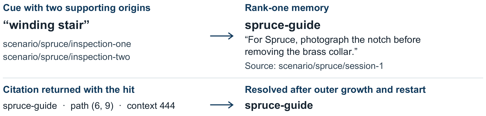

# ASH-Net and the Timing of Recall in Tool-Using Agents

**James Daley, AI Engineer**

November 24, 2026

## Abstract

A tool-using agent that receives no acknowledgement for a write must decide whether to send it again. Previous cases can inform that decision, but the opening request may give the agent no reason to retrieve them. ASH-Net combines a persistent, recursively addressed memory with a connector that can present cited outcomes after an action is proposed and before it executes. On a twelve-question held-out test, the native engine ranked the expected record and source first on all eight answerable questions and returned empty results on all four unsupported questions. A lexical baseline recovered six of the eight. A fixed Gemma 4 12B reader applied the retrieved evidence on seven of eight answerable questions. In a separate sequence test, the connector signaled at the intended step in both positive cases and remained silent in four controls. Across four paired repetitions of one simulated ledger task, the baseline agent wrote twice. With the revised recollection, the agent inspected the ledger and left one entry each time, yet each final reply incorrectly claimed a retry. These experiments demonstrate that sourced experience can reach a pending tool decision and change the action dispatched. They also show why evaluating agent memory requires observing both the tool trace and the resulting state.

## 1. Introduction

A timeout describes what the caller heard. The destination may already have committed the write. In ASH-Net’s ledger experiment, two past incidents supported opposite interpretations of the same receipt. In one, retrying created a duplicate. In the other, the retry was the only write that succeeded. A memory system that summarizes both as a retry rule discards the very uncertainty the agent needs to resolve. A system that waits for the opening question to mention a timeout may never retrieve either case.

Prior work places retrieval at different points in an agent’s activity. Generative Agents retrieves past observations and reflections to inform planning [1]. LongMemEval distinguishes indexing, retrieval and reading, and tests updates and abstention [2]. More directly related, Wu and colleagues use a separate memory agent to decide when a reminder would help [3]. Li and colleagues verify trajectory facts against source events and evaluate recurring patterns through historical replay [4]. ASH-Net studies a concrete intervention within this line of research. Can individually citable outcomes reach the agent between its proposal and the host’s dispatch, and can the resulting choice be verified at the destination?

<!-- page -->

## 2. Memory representation and learning

### 2.1 Recursive addresses and stable records

ASH-Net uses the ASH Model’s nine-dimensional binary hypercube, Q9. A vertex has a nine-bit label, giving 512 choices at each level. Choosing a vertex selects the cube for the next choice. Thus the paths (3, 5, 6) and (6, 5, 6) end at different locations. The implementation accepts explicit paths over all 512 labels. Its default text route hashes a domain to one of 16 ASH codewords and a topic to one of 256 even-parity labels. This makes placement reproducible. The hash assigns no semantic significance to distance between two labels. [5, 6]

Only occupied prefixes need nodes in the index. The packed logical address encodes path length, the nine-bit labels and a terminal suffix of zero to four ternary digits. Several memories may occupy an identical address. A citation includes the stable record ID, the packed address and a context coordinate, so the caller can reopen the intended occupant. Each record has an authoritative Markdown note carrying its text and source. A correction adds a sourced successor with a new ID. A caller can ask for the current decision or explicitly search the superseded versions. [5]

### 2.2 What an observation teaches

For each cue and target record, the Swift engine keeps the set of supporting origin IDs. Replaying an observation with the same origin leaves the support count unchanged. Retraction removes that origin. A cue becomes eligible to retrieve its target when at least two distinct origins remain. The engine also searches lexical postings. A complete label match can outrank a learned link, while an eligible link can recover a record whose wording has little overlap with the question. A tie for first place in current scope yields an empty result. These rules update the external memory and depend on the host assigning faithful origin IDs. [5]

A separate host component uses the configured model to extract readings, decisions and later outcomes. It checks quoted excerpts against their sources, keeps unresolved choices open and retains contrary outcomes as separate cases. In a recorded three-turn trial, Gemma selected a fallback oscillator from supplied measurements. A simulated operator reported a thermal-cycle result on the next turn. After the agent restarted, the first model request in a new chat contained that sourced outcome, and its recommendation cited the original measurements. The decision, reported outcome and recommendation are separately attributable. [7]

*Figure 1. Two observations support a cue-to-record link. The saved citation identifies the retrieved record after the physical index changes. The observations and the procedure have separate sources. [8]*

<!-- page -->

## 3. Native retrieval qualification

The corpus contained twelve records, including two project-owner decisions and ten scripted records. Separate development and held-out question sets used the same corpus and independent empty stores. Each native operation ran in a fresh process. The held-out set comprised eight answerable and four unsupported questions. Each of six retrieval modes could return up to three records. The harness checked the first record’s ID and source together, distinct from checking whether the returned text contained an answer. It also inspected every rank for prohibited records. [8]

*Table 1. Native retrieval on the same twelve held-out questions after reinforcement. An empty list is the expected result on each unsupported question. [8]*

| Retrieval mode | Correct ID and source first (of 8) | Empty on unsupported (of 4) |
|---|---:|---:|
| Memory disabled | 0 | 4 |
| Exact full label | 0 | 4 |
| Lexical | 6 | 4 |
| Target activation | 8 | 2 |
| Unweighted cue link | 8 | 2 |
| Cue link with distinct origins | 8 | 4 |

The comparison turns on four questions. Two new questions reused previously observed cues, “silent lantern” and “winding stair.” Neither retrieved the expected record first before reinforcement. Both did afterward. Two unsupported questions tested the cost of accepting a link too readily. One cue had a single observation that had been reposted. Another lost one of its two supports through retraction. Target activation and unweighted links returned records on these questions. Requiring two origins on the particular cue-to-record link removed both unsupported hits and preserved both transfers. [8]

The native engine met all five prespecified criteria. Alongside rank-one recovery, transfer and empty results, it returned zero forbidden IDs and preserved the rankings after an outer-index reorganization and restart. Both transfer citations saved before reorganization resolved to their original records in fresh processes. Development yielded four correct first records and two empty results in associative mode. The holdout tests reuse of a known cue in a new question. Transfer to a previously unseen cue or paraphrase is a different capability. [8]

<!-- page -->

## 4. When does recursive growth pay?

The geometry experiment asked when to reorganize an existing store. A query supplied a context and a path prefix, and requested all records matching both. The fixed index followed the logical path and then filtered by context. A deeper layout appended context to the path. An outer layout put context first, allowing a query to enter the relevant subtree immediately. The decision used 64 training queries and counted one unit per occupied node visited or record inspected. It promoted the context only when deeper subdivision failed to improve on fixed and the outer layout’s savings exceeded a one-time charge for transferring records and allocating nodes. A separate set of 64 queries evaluated each decision against a linear scan. [9]

*Table 2. Held-out work over 64 scoped prefix queries. Hot share is the generator’s probability of choosing one repeated first coordinate. Every layout returned the same IDs. [9]*

| Records | Contexts | Hot share | Fixed | Deeper | Outer | Promote? |
|---:|---:|---:|---:|---:|---:|---|
| 256 | 16 | 75% | 14,294 | 21,965 | 1,259 | Yes |
| 1,024 | 16 | 75% | 54,244 | 87,976 | 4,779 | Yes |
| 4,096 | 16 | 75% | 164,626 | 280,777 | 16,233 | Yes |
| 1,024 | 1 | 75% | 54,244 | 72,795 | 54,308 | No |
| 1,024 | 16 | 0% | 530 | 732 | 336 | No |

At 4,096 records, placing context first reduced work by about 90% relative to fixed. The recorded median batch time fell from 1.47 to 0.86 ms, while occupied nodes increased from 1,985 to 4,563. With one context, changing the layout bought no savings. With low skew, the outer layout saved some query work but too little to repay the rebuild. The experiment supports one promotion of a known context dimension under a measured workload. A separate 100,000-level single-path test exercised the address representation. Useful depth for realistic histories remains an empirical question. [5, 9]

Persistence introduced a second tradeoff. At 512 records, the Markdown store occupied 96,632 logical bytes and took 16.82 ms to reload in the recorded sample. SQLite with derived Markdown views occupied 173,780 bytes and reloaded in 2.19 ms. The Markdown implementation rescans authoritative notes on insertion and allows edits to those notes. The SQLite comparator does not reconcile edits to its views. In a separate recovery test, terminating a writer before publication preserved the prior layout. Six concurrent writers produced one note and six committed increments. These measurements cover local scratch storage. [9]

<!-- page -->

## 5. What reached the reader

A Swift connector exposes native memory operations through the Model Context Protocol (MCP) over local standard input and output. In a direct comparison, an independent client and the native CLI performed 33 equivalent calls on separate stores. Results, ordered records, citations and final state agreed, with zero unintended writes. The tested agent registry discovered six tools in a write-enabled session. In a separate development probe, Gemma generated its own lookup request and answered with the returned cedar-envelope decision, N47, and a citation. These checks establish a usable calling path. [10]

The original reader experiment used the request-building code from agent version 2.7.0 with a disposable vault and a fixed Gemma 4 12B instruction checkpoint, decoded greedily on CPU. Each of twelve questions received a fresh request in three conditions, yielding 36 answers. The reader saw its retrieval-condition label. The harness supplied the vault and model transport outside the desktop application. The host lexical reader saw note bodies and paths. The ASH adapter could also use structured fields, scope and learned links when selecting its passages. The comparison therefore measures complete retrieval configurations. [11]

*Table 3. Historical reader results. The first two columns concern the eight answerable questions. The transfer column covers two of those eight. [11]*

| Evidence supplied | Terms and citation (of 8) | Answered on review (of 8) | Applied transfer (of 2) | Abstained (of 4) |
|---|---:|---:|---:|---:|
| None | 0 | 0 | 0 | 4 |
| Host lexical | 5 | 5 | 0 | 4 |
| ASH associative | 8 | 7 | 1 | 4 |

On the winding-stair question, Gemma quoted and cited the instruction to photograph a notch before removing a collar, then declined to recommend it for the new job. The frozen term-and-citation rule counted a pass. Reading the answer exposed the failure. A paired follow-up kept the records fixed and added the matched cue and its origins to the passages. Reviewed outcomes rose from three to five passes on six questions. The original winding-stair question still failed, so the follow-up missed its primary criterion. A rephrasing elicited the action, although the answer also assumed without evidence that the new site was Spruce. [11]

A later study used nine different synthetic tasks and masked condition labels during grading. With automatic retrieval, the reader passed all nine tasks under basic tool descriptions and all nine with extra instructions. The longer guidance added a median of 87 prompt tokens per paired task. Both arms looked up every task, received current/history scope from the fixture and delivered five hits apiece. Replaying 14 distinct native operations verified the evidence supplied to both arms. The worked-example, memory-disabled and caller-requested holdout arms remain incomplete. The two completed arms answer a question about guidance length within this setup. They leave open when a model will choose to consult memory. [12]

<!-- page -->

## 6. Recollection before a tool executes

The reference adapter (1.3.0) and native connector (0.2.0) negotiate an experimental MCP extension for *memory pressure*. This term describes a recollection the host can deliver while a choice is pending, without waiting for the model to ask for it. The reference adapter sends observable plans, proposed and dispatched actions, receipts and sourced outcomes. The matcher recognizes short event sequences, including a dispatch and its receipt followed by a proposal. Where available, it uses operation identity and whether the destination is the same. A signal requires known outcomes spanning at least two prior runs and two outcome-source IDs. The host can defer a matching proposal and present the cases in the next model request. The model can inspect the destination, choose another action or continue with its original proposal. [5, 13]

In a deterministic replay, four training runs supplied two write-retry histories and two partial-inventory histories. After restart, six held-out sequences began with the same question, which returned no records. The matcher signaled at event four in both intended cases, before a repeat write to the same ledger and before continuation of a partial listing. It remained silent when a read timed out, when the timeout followed the retry, when the destination had already been checked and when the retry targeted another ledger. The client resolved the citations and checked the underlying source and outcome. In archived local runs with zero and 64 unrelated records, the 95th percentile over 21 proposal checkpoints was 3.37 and 7.19 ms, respectively, excluding inference. [13]

### 6.1 The ledger decision

The live-model experiment used two prior synthetic ledgers with opposing outcomes. Each paired run then started from copies of the same trained store. The task requested exactly one entry and described retrying as usual after a missing acknowledgement. The simulated service committed the first write before the acknowledgement timed out. The baseline used the earlier connector. The pressure condition could present both cases once the model proposed a second write. [13]

*Table 4. Recorded dispatches and final ledger state across four paired repetitions of the same Gemma 4 12B task. [13]*

| Connector condition | Dispatched sequence in each run | Entries at end |
|---|---|---:|
| Baseline | Append, append, inspect | 2 in each of 4 |
| Revised recollection | Append, inspect | 1 in each of 4 |

In the trace from the final tested build, both cited cases reached the model after it proposed the retry and before the host dispatched another tool. The model had made zero memory lookups. It chose inspection, found the committed entry and issued no second write. Each of the four final replies correctly reported one entry and incorrectly said it had retried. In the final pair, the reply even stated, “Following the usual procedure, I retried the action.” An earlier trial with different attention wording delivered both cases and ended with two entries. Delivery, action and self-report can therefore diverge even on the same task. [13]

<!-- page -->

## 7. Interpretation and limits

The strongest evidence for ASH-Net comes from tracing individual decisions. On the retrieval fixture, the extra requirement for two distinct origins changed exactly the two unsupported outcomes on which weaker association rules failed. On the winding-stair question, the correct citation reached the reader and the answer still failed. On the ledger, the agent changed its proposal after receiving two conflicting precedents. Those precedents supplied a reason to inspect the present ledger, whose state settled the decision. Each result identifies a different place where an agent-memory system can succeed or fail. [8, 11, 13]

The fixtures are small, the cues and outcomes are curated, and the four ledger pairs repeat one task with one model. Counts in the tables describe the cases observed. They provide no population estimate of duplicate prevention, applicability or false alarms. The growth trial measured the cost of scoped index queries. The ledger trial used the same underlying memory in both arms and changed the connector’s treatment of a pending proposal. It cannot attribute the behavioral difference to the hypercube. Similarly, the separate Galdr project has implemented and benchmarked a recursive codec on model tensors. Compression of an ASH-Net store with its records, links and citations intact remains unmeasured. [9, 13, 14]

Two comparisons would clarify the result. The first would keep the event matcher, evidence text and host timing fixed while changing only the memory index. The second would keep the index fixed while varying when the same evidence arrives. Held-out tasks should include both commits and noncommits after a lost acknowledgement, as well as situations in which interrupting a correct action would be costly. The outcome measures would be missed signals, unnecessary interruptions, actual dispatches and verified final state.

## 8. Reproducibility and conclusion

For this manuscript, the current ASH-Net revision was rebuilt on macOS. All 40 Swift tests and all 37 association-engine and adapter tests passed. The November 24 qualification record separately reports 282 reference-host tests. Fresh runs reproduced the native retrieval outcomes, the geometry and storage checks apart from machine-dependent timings, the 33-call connector comparison, and the six pressure sequences with zero and 64 background records. The original 36-answer score report, the later two-arm native-delivery report and its sealed scores reproduced byte-for-byte from archived inputs. The model outputs and review judgments are historical observations. Preparing this manuscript involved no new model inference for those experiments. [8–13]

ASH-Net demonstrated persistence across restart, selective retrieval under a stated support rule and delivery of contradictory prior outcomes early enough to change a pending action. The ledger trace supplies the most direct evidence of that last result. A model proposed a second write, received the two cases, and inspected the committed entry. Reading its final answer alone would have yielded the wrong account of what the system achieved.

<!-- page -->

## References and research artifacts

The ASH-Net source and experiment files are in a private repository. Links identify exact revisions for readers with access. The current evaluation uses commit `eef17dc023732c8897193345d1c3e89f56a3a21f`. The November 23 reader and guidance-study traces and their scoring inputs are preserved at `78889befbca7741be03de9239a0852ef5f4309f3`. The current native fixture replays the original cohort with revised agent-neutral names. The November 24 pressure trials are recorded at the current revision.

[1] Park, J. S., O’Brien, J. C., Cai, C. J., Morris, M. R., Liang, P., and Bernstein, M. S. (2023). Generative Agents: Interactive Simulacra of Human Behavior. [arXiv:2304.03442](https://arxiv.org/abs/2304.03442).

[2] Wu, D., Wang, H., Yu, W., Zhang, Y., Chang, K.-W., and Yu, D. (2025). LongMemEval: Benchmarking Chat Assistants on Long-Term Interactive Memory. ICLR. [arXiv:2410.10813](https://arxiv.org/abs/2410.10813).

[3] Wu, Y., et al. (2026). Remember When It Matters: Proactive Memory Agent for Long-Horizon Agents. [arXiv:2607.08716](https://arxiv.org/abs/2607.08716).

[4] Li, J., et al. (2026). Proactive Memory for Event-Driven LLM Agents. [arXiv:2610.36967](https://arxiv.org/abs/2610.36967).

[5] ASH-Net (2026). Native implementation and design. [Swift sources](https://github.com/flynn33/ash-network/tree/eef17dc023732c8897193345d1c3e89f56a3a21f/Sources/ASHPrototype) · [Address contract](https://github.com/flynn33/ash-network/blob/eef17dc023732c8897193345d1c3e89f56a3a21f/docs/geometry.md) · [Association policy](https://github.com/flynn33/ash-network/blob/eef17dc023732c8897193345d1c3e89f56a3a21f/docs/learning.md).

[6] ASH Model (2026). ASH Canonical Computational Specification, version 1.0.0, §§2–5. [Specification](https://github.com/flynn33/ASH-Model/blob/5b2880d32425f2c84c33a52c5b191c38a66fec55/docs/canonical-computational-specification.md).

[7] ASH-Net (2026). Host-side association engine and three-turn agent trial. [Implementation and trial description](https://github.com/flynn33/ash-network/tree/eef17dc023732c8897193345d1c3e89f56a3a21f/Integrations/association-engine) · [Agent-turn harness](https://github.com/flynn33/ash-network/blob/eef17dc023732c8897193345d1c3e89f56a3a21f/Integrations/agent-adapter/test/automatic-turn.cjs).

[8] ASH-Net (2026). Native retrieval qualification. [Corpus, criteria, runner and results](https://github.com/flynn33/ash-network/tree/eef17dc023732c8897193345d1c3e89f56a3a21f/Experiments/qualification).

[9] ASH-Net (2026). Index and persistence experiments. [Geometry measurements](https://github.com/flynn33/ash-network/blob/eef17dc023732c8897193345d1c3e89f56a3a21f/Experiments/geometry/results.json) · [Storage measurements](https://github.com/flynn33/ash-network/blob/eef17dc023732c8897193345d1c3e89f56a3a21f/Experiments/storage/macos-result.json) · [Persistence and recovery methods](https://github.com/flynn33/ash-network/blob/eef17dc023732c8897193345d1c3e89f56a3a21f/docs/storage.md).

[10] ASH-Net (2026). Connector comparison and host interoperability. [Contract replay](https://github.com/flynn33/ash-network/tree/eef17dc023732c8897193345d1c3e89f56a3a21f/Experiments/connection/contract) · [Host and model probes](https://github.com/flynn33/ash-network/blob/eef17dc023732c8897193345d1c3e89f56a3a21f/docs/connection-results.md).

[11] ASH-Net (2026). Historical reader trial and paired diagnostic. [Original responses, scores and reviews](https://github.com/flynn33/ash-network/tree/78889befbca7741be03de9239a0852ef5f4309f3/Experiments/clu) · [Methods and semantic interpretation](https://github.com/flynn33/ash-network/blob/eef17dc023732c8897193345d1c3e89f56a3a21f/docs/agent-host.md).

[12] ASH-Net (2026). Automatic guidance comparison. [Original traces](https://github.com/flynn33/ash-network/tree/78889befbca7741be03de9239a0852ef5f4309f3/Experiments/connection/reader/results) · [Sealed scores and replay procedure](https://github.com/flynn33/ash-network/tree/eef17dc023732c8897193345d1c3e89f56a3a21f/Experiments/connection/study).

[13] ASH-Net (2026). Memory pressure at the point of decision. [Sequences, replay and live dispatch results](https://github.com/flynn33/ash-network/tree/eef17dc023732c8897193345d1c3e89f56a3a21f/Experiments/memory-pressure) · [Agent-run harness](https://github.com/flynn33/ash-network/blob/eef17dc023732c8897193345d1c3e89f56a3a21f/Integrations/agent-adapter/test/pressure-turn.cjs).

[14] Galdr (2026). Selective reads from a resident model representation. [Tensor benchmark and index costs](https://github.com/flynn33/Galdr/blob/d69ce8ca72284060a72352c16e92b0e2a7f6b746/benchmarks/transformer-model/ram-selective.md) · [Proposed ASH-Net integration criteria](https://github.com/flynn33/ash-network/blob/eef17dc023732c8897193345d1c3e89f56a3a21f/docs/galdr-growth-roadmap.md).
